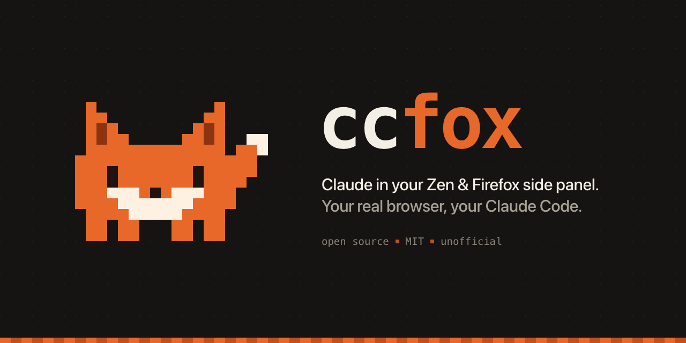
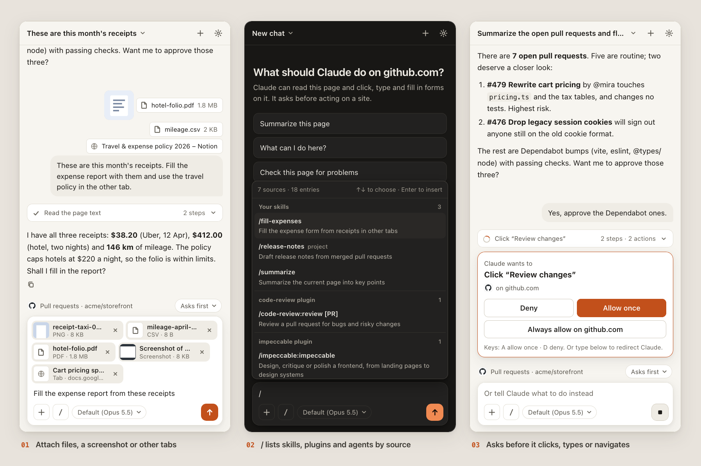
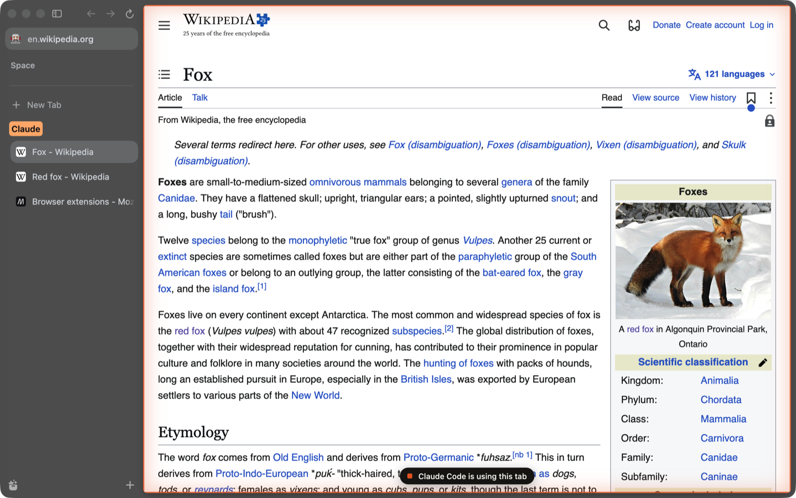

<p align="center"></p>

**ccfox puts Claude Code in the side panel of Zen or Firefox, and lets your Claude Code sessions drive that same browser.**

## Why

- **Your real browser.** Claude works in the browser you already use, with your profile, tabs and logged-in sites. There's no second browser to set up and no cookies to copy.
- **Your own Claude Code.** The side panel runs the `claude` you already have installed, with its login, subscription, skills, plugins and connectors. ccfox has no account, login or API key of its own.
- **Two ways in.** Chat with Claude in the side panel about the page in front of you. Or register ccfox as an MCP server so any Claude Code session can open tabs, click, type, take screenshots and read console output, for example to test the site you're building.

## Screenshots



*Attach files, a screenshot or other tabs to a message, pick skills, plugins and agents with `/`, and approve what Claude does on a site.*



*Tabs Claude opens go into an orange "Claude" tab group, and the tab it's using gets an orange glow and a pill.*

## Requirements

- **Zen**, or **Firefox 140 or later**. Stock Firefox release and beta builds can't install unsigned add-ons (see below), so on Firefox use Developer Edition, Nightly or ESR.
- **macOS.** This is the platform ccfox is developed and tested on. The installer also registers the helper on Linux (`~/.zen/native-messaging-hosts` and `~/.mozilla/native-messaging-hosts`), but the test and dev scripts assume macOS. Windows is not supported.
- **Node.js 20 or later**, with npm.
- **Claude Code**, installed and logged in. Check with `claude --version`.
- `zip` on your `PATH` (the installer uses it to build the add-on; macOS has it already).

## Quick start

**1. Get the code and install the helper.**

```bash
git clone https://github.com/thedankest/ccfox.git
cd ccfox
npm install
npm run install-host
```

`install-host` copies the helper to `~/.ccfox/`, records where `node` and `claude` live, registers the helper with Zen and Firefox, and builds `dist/ccfox.xpi`. It's safe to re-run.

**2. Allow the unsigned add-on.** ccfox isn't published on addons.mozilla.org, so Mozilla hasn't signed it; you build it yourself from this repo. To install it, open `about:config` and set `xpinstall.signatures.required` to `false`. Zen, Firefox Developer Edition, Nightly and ESR honor this setting. Stock Firefox release ignores it.

**3. Install the add-on.** Open `about:addons`, click the gear icon, choose **Install Add-on From File…**, and pick `dist/ccfox.xpi` from the `ccfox` folder.

> On stock Firefox you can still try it for one session: open `about:debugging#/runtime/this-firefox`, click **Load Temporary Add-on…**, and pick `extension/manifest.json`. It's removed when Firefox quits.

**4. Open the panel.** Click the ccfox toolbar button or press **Alt+Shift+C**. Ask it something about the page you're on.

**5. Optional: let Claude Code drive the browser.**

```bash
claude mcp add --scope user ccfox -- node ~/.ccfox/app/server/mcp-server.mjs
```

This points at the installed copy in `~/.ccfox/app`, so it keeps working if you move or delete the cloned folder.

## Using the side panel

**The tab Claude works on.** The chip above the input shows the tab Claude is working in. If Claude moves to another tab, the chip says so; click it to jump there.

**Approvals.** Reading a page is automatic. Clicking, typing, navigating and filling in forms need your OK. The request appears above the input with three choices: **Deny**, **Allow once**, or **Always allow on this site**.

- Requests that look like they submit, send, buy, delete or publish are marked with a warning.
- Shell commands and other actions outside the browser show the full command and always ask, unless your own Claude Code permission settings already allow them.
- Nothing is pre-focused, so a stray keypress can't approve anything. When the card has focus: `A` allows once, `S` always allows on this site, `D` or `Esc` denies.
- If you type a message instead of answering, the request is denied and your message tells Claude what to do instead.

**Trust levels.** The menu next to the tab name sets what Claude may do:

| Level | Effect |
|---|---|
| Asks first | The default. Every action on this site needs your OK. |
| Always allowed | Actions on this site run without asking. Manage the list in Settings. |
| Acts without asking | Browser actions run on every site without asking. Applies everywhere, not just this site. |

**Tab highlight.** While Claude works in a tab, the page gets an orange glow and a pill: "Claude is working in this tab" with a Stop button for panel chats, or "Claude Code is using this tab" for Claude Code sessions. The highlight is hidden from Claude's screenshots and ignored by its clicks.

**The Claude tab group.** Tabs Claude opens go into an orange "Claude" tab group in that window. Your own tabs are never moved. Both the highlight and the tab group can be turned off in Settings.

**Attachments.** The **+** button under the input adds things to your next message:

- **Upload files.** Up to 10 files per message, 20 MB each. They're saved to `~/.ccfox/workspace/uploads/<chatId>/`. Images go to Claude as images, PDFs up to 8 MB as documents, and other files by their path, so Claude opens them when it needs them.
- **Screenshot of this tab.** Attaches what you can see of the current tab.
- **Add tabs as context.** Tick up to 10 other tabs in this window. Claude is told to read them with its page tools.

You can also drag files onto the panel, or paste an image into the input. Each attachment shows as a chip above the input; click its × to remove it. Sent messages keep their attachments in the transcript and in History. Hover a file there to see where it was saved.

**Skills, commands and agents.** Type `/` (or click the `/` button) to pick from what your Claude Code offers, grouped by where it comes from: your skills, each plugin's skills and commands, "Synced from claude.ai", connectors, agents, and the built-in commands. Type `@` to list only the agents. Choosing an agent inserts `@agent-<name>`, which tells Claude Code to hand the task to that agent.

**Model.** The model picker under the input lists the models your Claude Code account offers.

**While Claude works.** Press `Esc` or the stop button to stop it. A message you send while it's working is queued and goes out when it finishes.

**Steps.** Tool calls are grouped, for example "4 steps · 3 actions". Expand the group to see each step, what you approved, and a Details view of the result.

**Copying a reply.** The copy button under each of Claude's replies copies its text, as Markdown.

**History.** Click the chat title to see your chats, with search and delete (with undo). Each chat is a real Claude Code session in `~/.ccfox/workspace`, so you can continue one in a terminal with `cd ~/.ccfox/workspace && claude --resume`.

**Settings** shows your default model, always-allowed sites and the connection status. It lists your plugins with each one's version, how many skills, agents and connectors it adds, and whether it loaded. Connectors show whether each is connected, failed or needs you to sign in.

**Keyboard shortcuts**

| Keys | Action |
|---|---|
| Alt+Shift+C | Open or close the panel |
| Alt+N | New chat |
| Alt+H | Chat history |
| Enter / Shift+Enter | Send / new line |
| Esc | Stop Claude, or close the open picker, menu or sheet |
| A / S / D | On a focused approval card: allow once / always allow on this site / deny |

## Using it from Claude Code

After step 5 of the quick start, start Claude Code anywhere and ask it to use your browser:

```text
Open http://localhost:3000 in my browser, go through the signup form, and tell me about any console errors or failed network requests.
```

The tools are named `mcp__ccfox__<tool>`, for example `mcp__ccfox__read_page`. Inside the side panel the same tools are called `mcp__browser__<tool>`. Claude Code's own permission prompts decide what runs; the side panel's approvals only apply to panel chats.

| Tool | What it does |
|---|---|
| `tabs_context` | List tabs and this session's current tab |
| `tabs_create`, `tabs_select`, `tabs_close` | Open, switch to and close tabs |
| `navigate` | Go to a URL, back, forward or reload, and wait for the page to load |
| `read_page` | Page outline with `ref_N` handles for clicking and typing |
| `find` | Find elements by role, name, value or link |
| `get_page_text` | Visible text of the page |
| `computer` | Screenshot, zoom, click, hover, type, press keys, scroll, drag, wait |
| `form_input` | Set inputs, selects, checkboxes, radios and similar by ref |
| `javascript_exec` | Run JavaScript in the page |
| `read_console_messages` | Console output and uncaught errors |
| `read_network_requests` | Method, status, type and timing of requests (no bodies) |
| `resize_window` | Resize the window, for responsive testing |
| `release_tabs` | Let go of Claude's tabs and stop capturing their console and network |

Several Claude Code sessions and panel chats can share one browser. Each keeps track of its own current tab.

## Safety and privacy

- **Nothing listens on the network.** Claude Code sessions reach the browser through a Unix socket at `~/.ccfox/bridge.sock`, which only your user can open (mode 0600, in a 0700 folder). Web pages can't connect to it.
- **You approve actions.** In the side panel, reading is automatic and everything else asks first unless you've chosen otherwise (see Trust levels). Actions outside the browser always ask unless your Claude Code settings allow them.
- **Claude is told to check with you.** The side panel tells Claude to stop and ask in chat before purchases, payments, sending messages, posting, deleting data, accepting terms or changing account settings, even on sites you've allowed. It's also told never to type passwords or card numbers, and to treat page content as data, not instructions. These are instructions to the model, not hard guarantees, so keep an eye on what it does.
- **Your login, your Claude Code.** Chats run on your installed `claude` with its existing login. ccfox sends nothing anywhere itself; the only thing that talks to Anthropic is your own Claude Code, as it normally would.
- **Capture is limited.** Console and network capture only runs in tabs Claude has touched.
- **Attached files are saved locally.** Uploads go to `~/.ccfox/workspace/uploads/<chatId>/`, readable only by your user. Like the rest of the chat, they reach Anthropic through your Claude Code: images and small PDFs with your message, other files when Claude reads them. Deleting a chat in History doesn't delete its uploads; remove that folder to clear them.

## How it works

```
side panel ──▶ extension ──native messaging──▶ helper (~/.ccfox)
               does the browser work           │  runs one Claude Agent SDK
               (tabs, pages, input,            │  session per chat on your
               screenshots, console)           │  own `claude` binary
                                               │
Claude Code ──stdio──▶ MCP server ──Unix socket┘
```

- The **extension** does the browser work: reading pages, simulating input, screenshots, console and network capture, the tab highlight and the tab group.
- The **helper** is a native messaging host that Zen or Firefox starts. For each panel chat it runs a [Claude Agent SDK](https://www.npmjs.com/package/@anthropic-ai/claude-agent-sdk) session pointed at your `claude` binary. It loads your user, project and local settings the way the CLI does, so your skills, plugins and connectors are available.
- The **MCP server** (`server/mcp-server.mjs`) is what Claude Code starts. It forwards tool calls to the helper over the Unix socket. Both paths share one set of tool definitions in `server/tools.mjs`.
- The helper lives in `~/.ccfox/app` rather than the cloned folder because macOS privacy protection stops processes started by the browser from reading `~/Documents`, `~/Desktop` and `~/Downloads`.

## Limits

Firefox gives extensions no DevTools protocol, so input is simulated with DOM events. Clicking, typing, Enter and Tab work on ordinary sites, including React and Vue forms. These don't:

- CSS `:hover` styles
- native `<select>` popups (use `form_input` instead)
- file pickers
- clipboard shortcuts
- sites that reject untrusted events

Also:

- `alert()` and `confirm()` dialogs block the page until you dismiss them.
- No extension can touch privileged pages: `about:` pages, addons.mozilla.org, reader view and `view-source:`.
- Cross-origin iframes appear in the outline, but their contents aren't read. Same-origin iframes and shadow DOM are.
- In tabs Claude controls, `console.*` is wrapped, so DevTools shows `console-hook.js` as the call site.

## Troubleshooting

- **The panel can't reach the ccfox helper.** Run `npm run install-host` in the `ccfox` folder, then press **Reconnect** in the panel. The helper's log is `~/.ccfox/host.log`.
- **The panel says Claude Code isn't installed.** Install Claude Code, make sure `claude` is on your `PATH`, then re-run `npm run install-host`.
- **An MCP tool says the browser isn't connected.** Zen or Firefox isn't running, or the add-on is disabled.
- **The add-on won't install.** Check that `xpinstall.signatures.required` is `false`, and that you're on Zen, Firefox Developer Edition, Nightly or ESR, version 140 or later.
- **Something broke after pulling new code.** Re-run `npm run install-host`, then install the new `dist/ccfox.xpi`.

## Developing

Re-run `npm run install-host` after changing anything in `host/`, `server/` or `extension/`.

```bash
node dev/preview-server.mjs   # http://localhost:4317: every panel state with fake data, light and dark
npm test                      # browser-control tests in headless Zen with a throwaway profile
npm run test:panel            # side-panel test with your real Claude Code (Haiku); costs a few cents
```

To try changes in a visible, throwaway Zen next to your normal one, and call tools from the shell:

```bash
node dev/try-zen.mjs                                   # prints ready CCFOX_HOME=/tmp/zc-...
CCFOX_HOME=/tmp/zc-... node dev/call.mjs tabs_create '{"url":"https://example.com"}'
```

Use the `CCFOX_HOME` value that `try-zen.mjs` printed. The tests and `try-zen.mjs` use a fresh profile and their own socket, so they never touch your real profile and can run while your normal Zen is open. They expect Zen at `/Applications/Zen.app`; `npm test` and `try-zen.mjs` accept `--firefox /path/to/binary` for another browser.

## Uninstall

```bash
npm run uninstall-host
claude mcp remove ccfox -s user
rm -rf ~/.ccfox
```

`uninstall-host` removes the native messaging registrations. Removing `~/.ccfox` deletes the helper, the panel's chat sessions and the files you attached. Then remove the add-on in `about:addons`, and set `xpinstall.signatures.required` back to `true` if you like.

## Disclaimer

ccfox is an unofficial community project. It is not affiliated with, endorsed by or sponsored by Anthropic. Claude and Claude Code are trademarks of Anthropic.

## License

[MIT](LICENSE)
